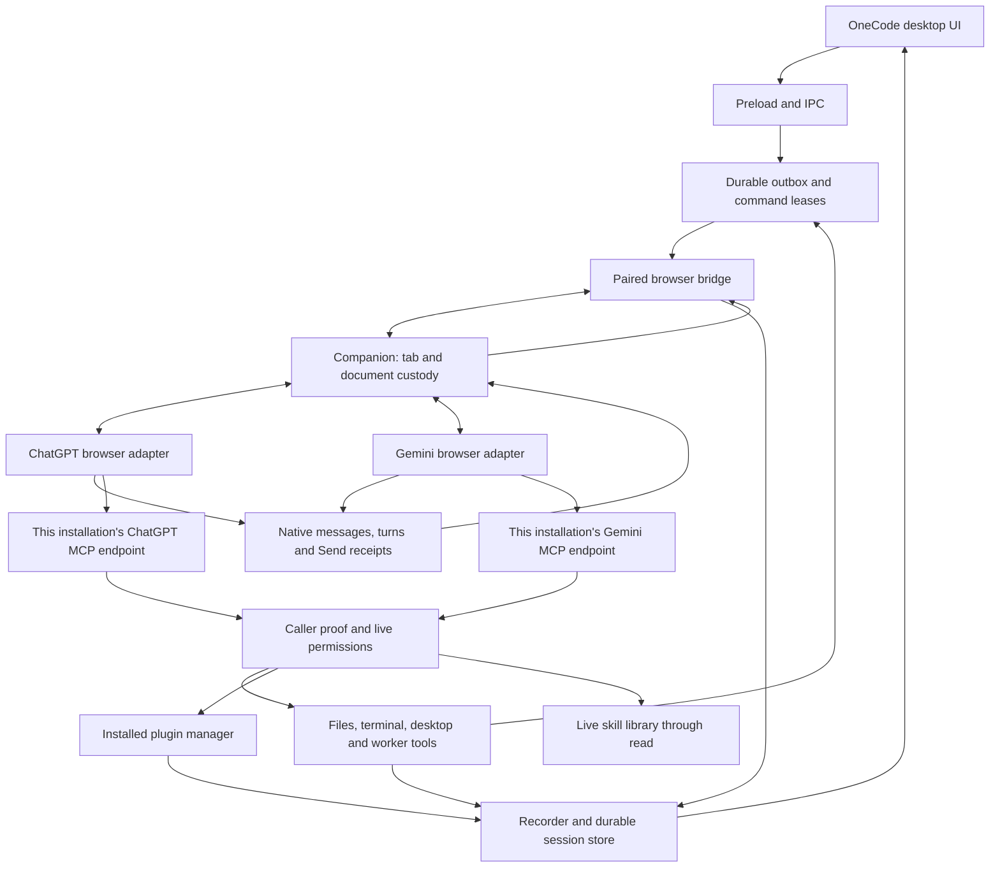

# OneCode architecture

OneCode is a desktop workspace that connects browser AI providers to local projects, tools, plugins, skills and managed chats. The Electron app and Companion extension share delivery, history, permissions and worker coordination. ChatGPT and Gemini are adapters within that architecture. The user's provider account runs the model; OneCode supplies local execution and workspace coordination.

This map describes current source ownership. It does not certify that an unreleased repair is installed or accepted in a live browser. Source versions are declared in `package.json`, `src/main/version.ts` and `extension/manifest.json`.

## Data and control flow

The browser bridge and MCP listener have separate authentication. Companion pairing alone does not identify an incoming model tool call. Each device owns its own MCP links and local state. Provider endpoints and session claims stay separate even while several chats or provider accounts are active.

## Ownership map

| Area | Primary source owners | Contract |
| --- | --- | --- |
| Product and profiles | `src/main/app-identity.ts`, `index.ts` | OneCode identity, startup, profile migration and shutdown |
| Provider contract | `src/shared/chat-provider.ts`, `src/main/chat-models.ts` | Provider keys, identities, URLs, observed model availability and capabilities |
| Native output admission | `src/shared/native-output.ts`, `src/main/bridge.ts` | Registered provider message/asset/revision contracts, exact conversation envelope and explicit original-export capability |
| Desktop UI | `src/renderer`, `src/preload`, `src/main/ipc.ts` | User actions, settings, workspace/timeline projections; no independent execution authority |
| Remote UI | `src/remote`, `src/main/remote`, `src/main/tunnel/tailscale-serve.ts` | Bundled React UI on private Serve, explicit app actions and safe projections; uses the same outbox and exact native-turn owners as desktop |
| Input and browser commands | `session/input.ts`, `bridge.ts`, `extension/background.js`, `content.js` | Durable intent, exact claim/lease, Send authorization and native receipt; no replay after an ambiguous Send |
| ChatGPT adapter | `extension/chatgpt-dom.js`, `fiber.js` | Native composer, conversation, message and tool-call observations |
| Gemini adapter | `extension/gemini-dom.js`, `gemini-markdown.js`, `gemini-routing.js` | Native UI, Markdown, account/document routing and provider-specific binding warm-up |
| Tool admission | `mcp/server.ts`, `inbound.ts`, `call-context.ts`, `kernel.ts` | Provider-scoped ingress, caller proof, sandbox/permissions and nested-call inheritance |
| Local capabilities | `gemini/bindings.ts`, `session/local-binding.ts` | Exact local session/task grants; no fabricated provider identity |
| Sessions and history | `session/recorder.ts`, `store.ts`, `correlation.ts` | Canonical session, native turn, tool evidence and process lifetime |
| Workers | `agents.ts`, `bridge.ts`, `worktrees` | Parent family, worker slots, command ACK, verified worktree and finish/revival |
| Plugins | `plugins/manager.ts`, `mcp/plugin-discovery.ts`, `mcp/tools-plugins.ts` | Live installed tool schemas and policy; Core discovery dispatches through the same owner |
| Skills | `skill-library.ts`, `session/skill-prompt.ts`, `session/prompt.ts` | Live catalog, scoped reads and frozen selected instruction revisions |
| Projects and files | `projects.ts`, `sandbox.ts`, `workspace.ts` | Explicit project and root grants; project membership adds no permission |
| Continuation | `session/continuation.ts`, `goal.ts` | Exact same-provider handoff, Goal/Loop and durable objectives |
| Updates | `update.ts`, `update-all.ts`, `resources/updater/windows-update-helper.cjs` | Verified artifacts, install intent, safe shutdown, profile preservation and visible relaunch |
| Release highlights | `renderer/whats-new.ts`, `shared/whats-new.ts`, `ipc.ts` | Bundled installed-version highlights, lastSeenVersion acknowledgement after showing, pending-modal deferral and Settings reopen; no separate installation authority |

## Identity and concurrency

Core artifact presentations are durable app progress events owned by the exact session/provider. `artifact begin` records generating state; `create` or the approved-local-file `image`/`video` action publishes the completed inline result. Local MP4/WebM video is limited to 128 MiB, copied into session assets after stable-file checks, and played through bounded chunks with exact presentation/session membership. Desktop and authenticated Remote share that retained asset owner; releasing a player does not delete history. `open` is an explicit workbench presentation, separate from creation. The session store owns retained bytes, reference retirement and cleanup. Presentation images use the same recorded-membership check as other renderer images. This provider-independent path is separate from each adapter's native Canvas and generated-media observations; their exact identity and export-representation contracts are described below.

Interactive artifact documents use short-lived, bounded capabilities: the desktop's `onecode-artifact` protocol or the private remote listener's preview route. Each document has a sandboxed opaque origin, inline artifact scripts/styles and no network, parent bridge, Node, form or child-frame access. The main desktop/remote renderers retain their own strict script policy. Preview handles release documents on replacement/navigation. Background model presentation requests never change the selected desktop chat.

A local session is the durable work identity. A provider conversation is its current native frontend, and a turn belongs to an exact authored question/generation. A worker is a member of one verified parent family. A device connector suffix is presentation and selection, never proof of a tool caller.

Existing sessions derive their provider from stored conversation identity. New-chat preference changes cannot reroute an existing chat or worker. Prompt delivery, uploads and browser leases belong to each exact input/document; independent chats must not wait on a global prompt operation. Global update/shutdown barriers may still wait for all active work.

Worker delivery and liveness share one provider-independent command lifecycle. A native Send acknowledgement commits delivery; observing the worker's new turn retires the liveness clock while preserving the exact durable delivery receipt. Provider authorization adapters read that receipt or the same durably committed broker delivery while settlement is in flight. Retiring a transport must not revoke the freshly delivered task, and observing activity alone must never authorize an unacknowledged Send. `test/worker-delivery-receipt.test.ts` runs both event orders for every registered provider and requires an explicit adapter when adding one.

Browser adapters retain the existing draft lease through their own native preparation steps. Gemini's accepted tool-free warm-up may replace the fresh editor; after its exact conversation and empty replacement editor are confirmed, restoring the unchanged task transfers the existing command draft lease before authorization. A human draft is preserved and aborts the bootstrap. This preparation does not activate a worker capability or replay a task Send. ChatGPT has no Gemini warm-up; its native composer and pre-Send ownership checks remain adapter-specific.

Recovery owns each adapter and recorder as a pair. It probes the exact requested document before injection and preserves a healthy pair, refreshing ChatGPT's independent MAIN-world helper when needed. Concurrent repair attempts share one per-tab flight; a different document rechecks its own custody afterward. Replacing an adapter alone can erase callbacks still owned by a retained recorder. The recorder protocol revision fences replacement of older pairs; both provider repair paths and overlapping/replaced documents have regression coverage.

Each recorder captures its adapter instance at creation. A late static adapter/content injection may replace the global while retaining the healthy recorder; it cannot redirect that recorder away from its original binding resolver, claims and draft leases. Worker and Resume bootstrap regressions cover this injection order.

A reconciled recovery offer may replace an older pre-redeem recovery waiter or same-chat URL marker. It cannot replace a fresh bootstrap or a command that has started redemption. This retires stale browser waiting state without replaying a Send or touching a human draft.

Model Refresh prefers the selected native page on both providers. Gemini account routing filters out other account prefixes before discovery; a result from an account changed during inspection is rejected. Native locked or denied choices are excluded. Gemini's collapsed lane caption does not prove a versioned mode ID, so it projects the provider's current-model option; an open native menu can prove the selected ID. The desktop offers one Automatic choice rather than duplicating that compatibility option.

Refreshing native approval policy must preserve an existing task capability, including a dormant command grant. A policy read cannot replace the key already carried in the authored task, remove its Send-ACK requirement, or revive a cancelled command. The worker command binding tests exercise policy reads on both sides of ACK and after cancellation.

New outbox entries capture their provider when enqueued, before asynchronous preparation. Binding an opening to a foreign provider is rejected before changing its session or outbox identity. The provider picker is not routing authority for work already queued.

Desktop and remote hide the new-chat provider switch as soon as the first input is submitted. Provider-scoped model observations replace the visible catalog on switching; a prior provider's edited model or default cannot become a new provider's Send choice. Existing chats derive provider from their stored conversation or opening outbox.

Remote mode configures its dedicated private Serve route from Settings. Its remote-only key lives in OS-encrypted secret storage; the copied URL retains its fragment so a bookmark can reopen the same installation after a restart or update. The fragment never reaches HTTP logs or referrers. Browsers exchange it for independent revocable sessions and retain only that browser token in local storage. Opening the bookmark can renew expired admission; requests in an already open workspace never automatically replay. Disabling Remote clears active sessions and closes the listener while retaining its encrypted link key and empty route receipt. The same port is reused on restart; a replaced route fails closed instead of silently moving the bookmark. The trusted desktop offers an explicit Refresh link action for that conflict, choosing a new free private port while preserving the conflicting route. The HTTP service validates its exact private origin and route custody, exposes only explicit actions and projections, and never forwards arbitrary IPC, provider credentials or connector URLs. Durable operation receipts prevent replay after an uncertain reply. Serve and provider MCP Funnel serialize routing mutations while retaining separate port custody.

An accepted Gemini input immediately re-observes and flushes its exact native question after ACK. Escaped provider readback may be recognized by the Send verifier before the ordinary recorder can match composer text; the ACK supplies the frozen native message identity to that existing observer. A hidden page timer is not a prerequisite for publishing the input's turn. Changed text, message, route or lifetime cannot spend that receipt.

An exact native Send plus committed application ACK can publish its frozen question and open its turn while the browser source is still pending, including a mounted but unreadable bubble. Rendered presence is not a veto on this independent receipt. The same conversation, document epoch, receipt lifetime and new-generation/answer checks remain; the receipt is spent once and never resends the task. Later readable history does not open a second turn.

If native whitespace changes make a length-framed context unreadable, the exact accepted message and full task comparison can recover the original composer source from that same Send receipt. The observer records this question before opening its turn. Generation recovery cannot open a turn for a question that has neither been published nor acknowledged as a durable user anchor; otherwise it would inherit the previous question, including an older permission reply.

Gemini may render approval decisions as `Allow`/`Deny` user-query rows. Only an exact observed native decision click can classify such a row as a control exchange within the original task. Companion clicks register before dispatch; trusted manual clicks register at capture on the exact recognized decision controls. The adapter observes the original card's decision mutations so disabling and removing it in one native render does not lose that receipt. Unproved, expired, edited or foreign replies remain ordinary authored messages and cannot renew task authorization. Auto-approval labels include actual published titles only for tools enabled on that exact connector.

When available, an exactly joined native request ID can identify a ChatGPT call. Current ChatGPT source also supports an app-issued local task capability carried by the model, checked against the exact outbox or worker-command receipt. Gemini uses its own attachment/input/command capability flow. Both routes retain ordinary permissions, Block/Trust and exact parent checks. Allow unattributed calls grants no worker parent identity. Native RPC IDs, current tabs and recent activity cannot supply missing ownership.

Credentials belong to the device and provider endpoint that issued them. They are consumed before recording tool arguments and must never appear in public diagnostics. A stale, cancelled, rebound, blocked, expired or foreign grant must fail before execution. App-authored input/worker instructions refresh task authorization; tool schemas or connector names alone cannot repair a missing caller.

An unsent ChatGPT claim may reuse frozen prompt bytes only while their embedded process-local grant still matches that exact claim. Replacing the preparing document or restarting the app rebuilds its authorization before Send, preserving the authored task and attachments. Authorized or ambiguous sends cannot enter this preparation path. Both adapters allow the same bounded 120-second native receipt window for initial tool admission; waiting never substitutes for the exact accepted question and turn.

After the desktop input's exact ACK, both adapters promote its witnessed native message into the ordinary turn observer, including Markdown-escaped first messages. The submitted-text check excludes native connector chips in the same way as the captured Send receipt. The original history/adoption gate still resolves before journaling; rejected ACKs and replaced receipt, route or document cannot spend this promotion.

The accepted app-owned task retains its original length-framed source when a rich editor flattens paragraph separators. The exact ACK and full-task comparison own this recovery, within the same native receipt window. Releasing the desktop input slot queues one observation of that same still-current receipt after native Send cleanup; it cannot resend text.

ChatGPT upload custody retains only new remove controls created during the exclusive upload. A unique native numeric collision rename may bind before the first observation only with a retained unchanged draft. Completion must pass that draft's trusted-edit fence as well as file-count and Send-readiness checks. Another basename/extension, an extra file or a changed task cannot acquire the upload lease.

The native Send button's click and its form submission are one transaction. The exact button/form submission consumes the click's receipt once; a cleared editor with a lingering attachment tile cannot replace it with an attachment-only receipt. The current ChatGPT shell's search-unit question inside a shell exchange is read once by its native message ID and role, independent of positional layout keys.

A native search wrapper and nested legacy slot can describe the same question. Identified nested slots are resolved once; a nested positional view with no independent identity cannot make that question ambiguous. Distinct questions and unrelated duplicate slots remain refused. A short answer's explicit assistant Markdown wrapper also supplies the assistant section when the native search/agent-start wrapper is absent. Redacted layout and lifecycle counters report structural counts and ownership/completion booleans without prompt text, credentials or provider URLs.

Fresh ChatGPT commands can acknowledge the exact native Send POST before the readable question mounts, using the same receipt as ordinary desktop input. The committed command retires its lease normally; the accepted receipt and unchanged document still own the destination checkpoint and journal release afterward. An accepted question's frozen submitted bytes enter ordinary history before its turn when the native question is not yet readable. Mounted source/history rows cannot become that question by anchor absence. This preserves first-tool attribution without waiting for a renderer scan that can itself wait for that tool.

Resume credentials belong to the continuation's provider and original durable session, independent of the new-chat preference. ChatGPT checks the committed command, exact destination question and first live successor turn. Bootstrap Send reports its already-proved destination question to the existing continuation checkpoint immediately after ACK, before waiting for another native scan or picker refresh. This avoids making the first tool wait for a scan that can itself be waiting on that tool. Releasing the journal gate immediately re-observes the successor, including a response that finished during rebind.

A native completed turn stops the displayed Active indicator when no newer work exists. The underlying recovery watch may remain while final history finishes recording; that watch is not a running answer. Exact running tools and a newer live turn retain their own activity projection.

## Plugins, skills and provider features

OneCode 0.4.0 stages one Core connector per provider/installation for local files, terminal, permitted desktop/browser tools, managed skills and the external plugin gateway. Legacy surface endpoints remain compatible, but new setup and tool-change notices use Core. Capabilities and request-scoped identity continue to gate each action; consolidating discovery adds no permission.

Core and legacy Desktop register the same desktop/browser owners and schemas. Core code mode supplies the same Windows `sky` aliases. Native connector refresh accepts the expanded Core catalog on both sides of the bridge while retaining exact app/route identity, schema and size guards. A cached provider schema can discover newly permitted built-in methods through the stable Core `plugins` gateway. This changes discovery, not permissions or caller authority.

Core `skills` imports an approved file/folder into the same managed library the Skills page reads and returns the live catalog for verification. Core `plugins` can list installed integrations and install a requested source through the existing plugin manager under Command and Create permissions. Read-only mode refuses installation. Native `onecode-chatgpt` and `onecode-gemini` backend instructions remain separate from user-created local task skills.

Artifact schemas expose their action fields at the object root and retain strict conditional validation. A create can inherit its title only from its exact pending presentation. `patch` and `present` move the same inline card to the latest response; `open` explicitly requests the workbench. Preview defaults to responsive CSS pixels and retains fixed desktop/phone simulations. Opaque-origin documents get bounded document-local storage only when native storage is inaccessible; this grants no host storage, network or persistent origin.

Core always exposes local plugin discovery through `plugins` with `action: list`. Its live catalog comes from the installed plugin manager. Existing chats can use Core code mode when a provider cached an older direct-tool list. Follow-up preparation includes live discovery guidance and the exact configured connector name. This must work on both current providers without marketplace search or a new chat as the normal discovery step.

Local skills are provider-independent files and metadata. The virtual `/skills/.catalog.json` read reflects the live library within the caller's validated scope. Reading a skill body and freezing a selected revision are separate actions. A provider's optional native skill installation is an adapter feature, separate from OneCode's local skill library. ChatGPT Setup exports the bundled public onecode-chatgpt skill as Markdown or ZIP. The opt-in flag records user-confirmed activation and shortens reusable instructions; fresh exact-task credentials, permissions, selected skill revisions and durable provider routing remain unchanged. Export never installs remotely or includes device credentials.

Computer use is a reviewed CUA Driver recipe in the ordinary plugin manager. It discovers existing official installations outside a stale desktop PATH and connects an MCP proxy to the daemon's explicit reported endpoint. It never replaces an existing driver or changes its permission mode. An explicit install downloads a checksum-pinned upstream installer only when the driver is absent, then imports the complete upstream skill through the normal GitHub skill owner. Driver binaries and skill files are not vendored into this repository. Disconnecting OneCode closes its proxy, preserving the shared daemon. Installing the Computer use recommendation follows this same plugin setup.

A native stopped-turn observation reconciles a worker through the existing durable finish barrier immediately. It frees the slot while preserving the chat and unread queue, reports that work may be incomplete, and does not automatically wake queued work after an explicit Stop. An ACK for a stop click alone is not proof that the provider stopped; a historical stop cannot close a newer turn.

Automatic compaction reads tool-result receipts from every exactly stamped section of its logical source answer. A response split across native sections has no single Fiber descriptor. Missing or conflicting receipts still prevent Stop and Send. A failed pre-Send barrier records its reason and releases that ticket; browser pickup cannot renew an exhausted retry budget. Once dispatch is uncertain, the original transaction retains custody and is never resent on a timer.

Compaction checkpoints derive their provider from the browser's validated current source URL. ChatGPT carries a Fiber-question document; Gemini carries a native-question document and its account path. The bridge validates that receipt against the provider's conversation shape before permitting Send. Recorder protocol revisions replace retained older content closures when compaction behavior changes.

Every provider's compaction prompt requests a complete Markdown reply without tool calls. The recorder's exact source question, single completed generation, final message and settled tool state own capture and local storage; partial or interrupted prose cannot open a successor. Gemini retains its browser/document/account custody checks. The older scoped `save_handoff` tool remains compatible with already-issued prompts, but is no longer required by current compaction.

Only a page's handoff-capture reply may consume its replacement placement. The compatibility Gemini MCP `save_handoff` response cannot open a browser tab, so its capture leaves that offer with the ordinary browser status owner. A foreign browser cannot collect it, and the owning browser can collect it only once.

Gemini's replacement command carries its verified tool-free warm-up conversation at the destination checkpoints. ChatGPT still requests these checkpoints from its fresh, id-less route. Both pass the bridge's existing exact document and current route checks. A preparation failure before requesting destination dispatch fails the command visibly; after that request, even a lost reply retains custody because Send may have been armed.

The controlled Gemini warm-up can transfer its existing edit transition once when the native fresh editor is replaced before Send. The old host must be disconnected, the replacement must contain exactly the staged warm-up or the preceding proved-empty state, and its opening/command, route and attachments must still match. Empty-state transfer additionally requires disabled Send and no attachments; native paragraph/caret readiness remains mandatory. Trusted edits revoke the transition, and a different draft is preserved. This does not arm or replay the real task.

Context counts are local recorder estimates. The configured reference controls presentation and the automatic-compaction trigger; exceeding it cannot revoke a caller, stop a turn, or block authored input. A history-load HTTP 429 is separate transport evidence. Its retry deadline can include OneCode's own conservative backoff, so the interface must not attribute that deadline to the model or describe it as the provider's context capacity.

Native provider capabilities remain explicit: model selection, native projects, approval layouts, file uploads and generated-media export differ. Gemini generated images are admitted only through their exact response and native declared attachment index. The adapter captures already-loaded pixels and exports a rendered PNG; it does not claim the provider's separate full-size original download. Generated video uses the exact response-scoped native singleton, MIME, download control and rendered download URL. Ambiguous resources and ordinary embedded media are refused.

ChatGPT PNG file cards have a separate exact public file reference: canonical assistant message, sandbox path and basename. The native file download and preview buttons are leased to that reference. An automatic preview capture opens once only with no existing viewer or competing input, binds witnessed local-viewer pixels through its temporary lease, and closes only the unchanged owned viewer. Trusted user input revokes capture and preserves the touched viewer. A temporary viewer path never becomes provider identity. Resident history refresh updates existing canonical rows without admitting a new page or moving the live cursor.

Native output ingestion uses one normalized image/video/artifact pipeline. `CHAT_PROVIDER_DEFINITIONS` owns provider keys and routing; `NATIVE_OUTPUT_ADAPTERS` requires an explicit identity, export-representation and snapshot-surface contract for each key. The bridge validates observations against their conversation envelope. Gemini requires its exact rendered assistant identity and an explicit provider stamp; document-position fallbacks and foreign conversations are refused. Companion transfer support is independent of the default provider for new chats.

Gemini's rendered video download blocks page-origin fetches. A browser-only relay has narrowly scoped permission for the witnessed native download host. It accepts only an app-issued export nonce for the exact elected tab/document/message/resource, rechecks page ownership around every awaited chunk, and sends only bounded acknowledged bytes to the existing app export owner. Signed URLs remain inside the browser companion and never enter app RPCs, history or tool results. The long stream does not hold the per-tab mutation queue, so observations, Stop and steering receipts continue normally. The app validates MP4/WebM structure and publishes exclusively to the authorized destination.

Native HTML Canvas snapshots are distinct from provider-native artifact revisions. The adapter temporarily selects the native Code view under a route/document/user-interaction guard, reads Monaco's complete source only from the editor mounted inside that exact response, and restores Preview when its lease is unchanged. The native editor's transient URI/version is never treated as a Gemini resource or revision id. OneCode retains response-scoped source snapshots with local immutable revisions, one Generating-to-ready inline anchor, and no automatic workbench opening. Ordinary code fences are never promoted. Replays cannot overwrite local edits. Unsupported or oversized source fails the presentation; unknown or incomplete source remains unclaimed. Future providers register their own exact surface and export contracts without adding provider-specific chat UI branches.

## Reading and validation

An explicit authored Send can launch its marked provider URL when a browser process exists but its companion wake channel is unavailable. The queued input is rechecked after the process probe; collected, cancelled and shutdown work cannot launch it. Concurrent sends share that startup attempt. Automatic recovery and discovery retain their process-absence requirement.

After connector readiness, an already connected companion receives a fresh work notification. A marked new Gemini input with no open account context may open the normal native home once; the observed page then selects the account for preparation. This exception cannot choose between multiple live accounts or reopen an existing conversation with unknown account ownership.

A Gemini reply that stalls before its first local tool call can earn one page refresh after ten minutes without meaningful output (longer deliberate-thinking windows remain intact). The existing input owner must prove the exact committed native Send, recorded question and current open generation. The ordinary assistant-error claim and per-question budget own the action; fresh output, a newer question, Stop, completion or disabled continuation withdraws an unclaimed refresh. This refresh cannot authorize Stop, Continue or resend the task. Recognized native Gemini transport alerts are recoverable; account, quota and unknown alerts remain blocking.

Tailscale startup waits for transient daemon/network states without reopening sign-in. Public ingress races Cloudflare and Google DNS over HTTPS, pins only global addresses with the original TLS hostname, and requires the exact connector metadata and MCP initialize reply. A framed initialize SSE reply completes the check while its stream remains open. Read-only checks retry against the retained route; they never replay route mutations. Unrelated settings writes preserve the config owner's tunnel incarnation so an accepted post-update connection can finish; real tunnel edits still invalidate it.

Public TLS failure retains the exact native route but withdraws Connected while checks continue. On Windows the trusted desktop can explicitly request Repair public connection. The live Tailscale adapter rechecks node and route custody, the connection owner refuses running tool calls or a changed transport, and tailscale-repair.ts requests Windows consent to restart only the system Tailscale service. Concurrent requests share one restart. Polling never launches it, cancelled repairs are not replayed, and pre-repair probe results cannot establish post-repair readiness. Existing routes, account state, private Remote links and profile data are preserved; ordinary public DNS/HTTPS/MCP checks own recovery.

`browser.ts` owns installed-browser resolution for setup and app-authored launches. Windows checks the selected family's normal channel paths, PATH, per-user/machine App Paths and StartMenuInternet registrations, and matching running executable paths on any drive. Registration arguments are discarded and another family is never a fallback. An explicit local executable picker retains per-family paths through the config owner. Setup saves the chosen family before sign-in and passes that same family to the launch IPC; pending or rejected saves cannot open a previous selection.

Desktop Compact pickup acknowledges an exact live document before fetching its activity feed. The browser's IPC reply deadline must not reload that same document while a delayed feed response starts the handoff Send. An owner already between dispatch authorization and native acceptance retains custody. Actual Send, accepted question, saved Markdown and successor commit remain separate checkpoints for every provider; one provider's pending checkpoint cannot serialize another's.

An exactly matching route that Chrome still marks loading can refuse a checkpoint before forwarding it to the app. Source checkpoints and successor authorization both use the same bounded readiness wait for that explicit unforwarded refusal, including Gemini's named warm-up conversation. A changed document, foreign route, lost response or uncertain dispatch cannot use this retry. The compact status remains Preparing until durable source dispatch evidence exists.

Native approval policy reads live declarations from the requesting provider's endpoint explicitly. The UI's new-chat selector is only a presentation default and cannot select another existing chat's tools. Adapter-only tools must not be advertised by an endpoint that cannot validate their admission proof.

Session history remains in the canonical local store: message shards, append-only tool events and checksum-verified handoff Markdown. Core `read` exposes read-only `/sessions/.catalog.json`, per-session `history.md`, paged history and saved handoff paths from that store. It requires the live Read files permission, omits transport authorization and masks recognizable credentials. It never exposes the profile directory or grants execution authority from a historical instruction. Both providers discover these paths through the same tool schema and opening instructions.

Start with this map and `AGENTS.md`; then inspect the owner of the behavior being changed. `docs/MULTI-PROVIDER-COMPATIBILITY.md` records the adapter contract and remaining provider assumptions. `docs/UPSTREAM-ARCHITECTURE.md` preserves the historical upstream design and is not the current product map.

Validate source, a freshly built package, the installed app and the live native browser separately. Current repair acceptance must include independent same-provider chats, simultaneous ChatGPT/Gemini work, uploads, exact worker parent attribution, local plugin/skill discovery in existing chats, and Windows install/relaunch with the normal history preserved. Do not claim acceptance from source tests alone.

Late ChatGPT commentary is placed with its exact already-recorded native assistant message or consistently owned connector requests from the same native response descriptor. Conflicting response owners remain unclaimed, and a local turn cannot claim two native responses. This history placement cannot authorize a tool or mark a settled response as new activity.

Code mode routes image blocks from an explicitly printed native MCP result through the existing image emitter, validation and output budgets. It prints metadata with image placeholders instead of serialized base64. It never forwards unprinted tool results or parses arbitrary strings as images; dispatched actions retain their lifetime on output failure.

Remote project groups come from the local project owner and expose only IDs, names and colors. New-chat sends validate the current project and carry that association through the shared outbox/workspace owner; existing chats cannot be reassigned by a send. Project composers retain independent drafts, attachments, plans and unresolved receipts. Membership never grants an additional filesystem permission.

## Recurring local checks

`chat-schedules.ts` owns a strictly validated durable interval ledger. Core `automations` resolves the exact caller session and endpoint provider before creating, listing or changing a schedule. Existing chats can discover the tool through the live Core plugin gateway. Provider-native cloud Monitoring cards are not imported as local schedules. Both provider opening guidance and optional native skills describe the local feature.

Each due run durably reserves its original input UUID and message before admission to the ordinary outbox. Delivery waits for the existing turn and retains the same session/provider, Block/Trust, permissions, exclusive claim and native Send ACK guards. A restart reconciles the original outbox receipt; it never replays an ambiguous Send. Only one unresolved message is pending for each schedule; missed intervals coalesce to one message without shifting the original cadence. The app must remain running, the PC awake and the provider signed in. Queued, sent and completed work are distinct facts. Desktop and authenticated remote settings project the same owner and can cancel its pending input.

Application hotfix updates share update.ts, update-bootstrap.ts and the detached Windows helper with ordinary installation. update-hotfix.ts verifies and stages a complete allowed-resource snapshot. resources/updater/hotfix-contract.cjs supplies the packaging/runtime path and inventory contract. The after-pack hook fingerprints immutable native resources and the exact Electron version; a matching release capsule can update app.asar, Companion, skills and updater helpers without replacing Electron or native binaries. Explicit install intent and canonical work/shutdown fences still own activation. The helper verifies actual native files, preserves rollback copies and requires the expected application version plus a stable visible window. It restores a failed snapshot only while no successor is running; an unconfirmed running app is never terminated or overwritten.

Hotfix manifests can embed a verified complete-base descriptor. If the installed runtime is incompatible or cannot be patched directly, update.ts checks that descriptor against the exact base release's checksum list, downloads both artifacts and stages a single version-bound composite intent. Download progress follows received bytes across the complete plan. update-bootstrap.ts persists schema3 outside the install; the helper verifies the patch before base execution, installs the full release with intermediate relaunch suppressed, verifies its version/registration/native inventory, applies the patch and launches only the final app. Failed patch rollback restores that new base's application files, not the old native runtime. Full installer downloads use their selected tag's feed, and full release builds retain all hotfix commits already merged into main.

The after-pack hook records the actual full release's baseVersion in runtime.json. Application capsules cannot replace that file, so APP_VERSION never impersonates an installed full base. A required newer base, or a legacy missing receipt, forces the verified full-base path even when native hashes match. The desktop selector and detached helper share this compatibility rule.

Steering receipt baselines use the previous native user-message ID even while its source text is unreadable; the send owner and observer must not disagree based on text visibility. Current exact acknowledged ChatGPT inputs can earn one question-budgeted refresh after the normal 90-second silence window before first tool use, through the same authored-input repair owner as Gemini. Gemini retains its ten-minute first-response floor; Pro and deliberate-effort windows remain. A refresh does not itself earn Stop, Continue or another Send. Active progress, permission/Stop, running-tool and replaced-source fences are rechecked at claim.
