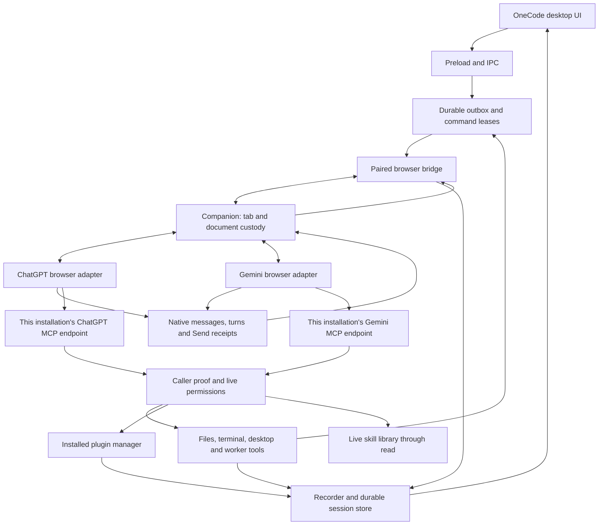

# OneCode architecture

OneCode is a desktop workspace that connects browser AI providers to local projects, tools, plugins, skills and managed chats. The Electron app and Companion extension share delivery, history, permissions and worker coordination. ChatGPT and Gemini are adapters within that architecture. The user's provider account runs the model; OneCode supplies local execution and workspace coordination.

This map describes current source ownership. It does not certify that an unreleased repair is installed or accepted in a live browser. Source versions are declared in `package.json`, `src/main/version.ts` and `extension/manifest.json`.

## Data and control flow

The browser bridge and MCP listener have separate authentication. Companion pairing alone does not identify an incoming model tool call. Each device owns its own MCP links and local state. Provider endpoints and session claims stay separate even while several chats or provider accounts are active.

## Ownership map

| Area | Primary source owners | Contract |
| --- | --- | --- |
| Product and profiles | `src/main/app-identity.ts`, `index.ts` | OneCode identity, startup, profile migration and shutdown |
| Provider contract | `src/shared/chat-provider.ts`, `src/main/chat-models.ts` | Provider keys, identities, URLs, observed model availability and capabilities |
| Desktop UI | `src/renderer`, `src/preload`, `src/main/ipc.ts` | User actions, settings, workspace/timeline projections; no independent execution authority |
| Input and browser commands | `session/input.ts`, `bridge.ts`, `extension/background.js`, `content.js` | Durable intent, exact claim/lease, Send authorization and native receipt; no replay after an ambiguous Send |
| ChatGPT adapter | `extension/chatgpt-dom.js`, `fiber.js` | Native composer, conversation, message and tool-call observations |
| Gemini adapter | `extension/gemini-dom.js`, `gemini-markdown.js`, `gemini-routing.js` | Native UI, Markdown, account/document routing and provider-specific binding warm-up |
| Tool admission | `mcp/server.ts`, `inbound.ts`, `call-context.ts`, `kernel.ts` | Provider-scoped ingress, caller proof, sandbox/permissions and nested-call inheritance |
| Local capabilities | `gemini/bindings.ts`, `session/local-binding.ts` | Exact local session/task grants; no fabricated provider identity |
| Sessions and history | `session/recorder.ts`, `store.ts`, `correlation.ts` | Canonical session, native turn, tool evidence and process lifetime |
| Workers | `agents.ts`, `bridge.ts`, `worktrees` | Parent family, worker slots, command ACK, verified worktree and finish/revival |
| Plugins | `plugins/manager.ts`, `mcp/plugin-discovery.ts`, `mcp/tools-plugins.ts` | Live installed tool schemas and policy; Core discovery dispatches through the same owner |
| Skills | `skill-library.ts`, `session/skill-prompt.ts`, `session/prompt.ts` | Live catalog, scoped reads and frozen selected instruction revisions |
| Projects and files | `projects.ts`, `sandbox.ts`, `workspace.ts` | Explicit project and root grants; project membership adds no permission |
| Continuation | `session/continuation.ts`, `goal.ts` | Exact same-provider handoff, Goal/Loop and durable objectives |
| Updates | `update.ts`, `update-all.ts`, `resources/updater/windows-update-helper.cjs` | Verified artifacts, install intent, safe shutdown, profile preservation and visible relaunch |

## Identity and concurrency

A local session is the durable work identity. A provider conversation is its current native frontend, and a turn belongs to an exact authored question/generation. A worker is a member of one verified parent family. A device connector suffix is presentation and selection, never proof of a tool caller.

Existing sessions derive their provider from stored conversation identity. New-chat preference changes cannot reroute an existing chat or worker. Prompt delivery, uploads and browser leases belong to each exact input/document; independent chats must not wait on a global prompt operation. Global update/shutdown barriers may still wait for all active work.

Worker delivery and liveness share one provider-independent command lifecycle. A native Send acknowledgement commits delivery; observing the worker's new turn retires the liveness clock while preserving the exact durable delivery receipt. Provider authorization adapters read that receipt or the same durably committed broker delivery while settlement is in flight. Retiring a transport must not revoke the freshly delivered task, and observing activity alone must never authorize an unacknowledged Send. `test/worker-delivery-receipt.test.ts` runs both event orders for every registered provider and requires an explicit adapter when adding one.

Browser adapters retain the existing draft lease through their own native preparation steps. Gemini's accepted tool-free warm-up may replace the fresh editor; after its exact conversation and empty replacement editor are confirmed, restoring the unchanged task transfers the existing command draft lease before authorization. A human draft is preserved and aborts the bootstrap. This preparation does not activate a worker capability or replay a task Send. ChatGPT has no Gemini warm-up; its native composer and pre-Send ownership checks remain adapter-specific.

Recovery owns each adapter and recorder as a pair. It probes the exact requested document before injection and preserves a healthy pair, refreshing ChatGPT's independent MAIN-world helper when needed. Concurrent repair attempts share one per-tab flight; a different document rechecks its own custody afterward. Replacing an adapter alone can erase callbacks still owned by a retained recorder. The recorder protocol revision fences replacement of older pairs; both provider repair paths and overlapping/replaced documents have regression coverage.

Each recorder captures its adapter instance at creation. A late static adapter/content injection may replace the global while retaining the healthy recorder; it cannot redirect that recorder away from its original binding resolver, claims and draft leases. Worker and Resume bootstrap regressions cover this injection order.

A reconciled recovery offer may replace an older pre-redeem recovery waiter or same-chat URL marker. It cannot replace a fresh bootstrap or a command that has started redemption. This retires stale browser waiting state without replaying a Send or touching a human draft.

Model Refresh prefers the selected native page on both providers. Gemini account routing filters out other account prefixes before discovery; a result from an account changed during inspection is rejected. Native locked or denied choices are excluded. Gemini's collapsed lane caption does not prove a versioned mode ID, so it projects the provider's current-model option; an open native menu can prove the selected ID. The desktop offers one Automatic choice rather than duplicating that compatibility option.

Refreshing native approval policy must preserve an existing task capability, including a dormant command grant. A policy read cannot replace the key already carried in the authored task, remove its Send-ACK requirement, or revive a cancelled command. The worker command binding tests exercise policy reads on both sides of ACK and after cancellation.

New outbox entries capture their provider when enqueued, before asynchronous preparation. Binding an opening to a foreign provider is rejected before changing its session or outbox identity. The provider picker is not routing authority for work already queued.

An accepted Gemini input immediately re-observes and flushes its exact native question after ACK. Escaped provider readback may be recognized by the Send verifier before the ordinary recorder can match composer text; the ACK supplies the frozen native message identity to that existing observer. A hidden page timer is not a prerequisite for publishing the input's turn. Changed text, message, route or lifetime cannot spend that receipt.

If native whitespace changes make a length-framed context unreadable, the exact accepted message and full task comparison can recover the original composer source from that same Send receipt. The observer records this question before opening its turn. Generation recovery cannot open a turn for a question that has neither been published nor acknowledged as a durable user anchor; otherwise it would inherit the previous question, including an older permission reply.

Gemini may render approval decisions as `Allow`/`Deny` user-query rows. Only an exact Companion click receipt can classify such a row as a control exchange within the original task. The adapter observes the original card's decision mutations so disabling and removing it in one native render does not lose that receipt. Unproved, expired, edited or foreign replies remain ordinary authored messages and cannot renew task authorization.

When available, an exactly joined native request ID can identify a ChatGPT call. Current ChatGPT source also supports an app-issued local task capability carried by the model, checked against the exact outbox or worker-command receipt. Gemini uses its own attachment/input/command capability flow. Both routes retain ordinary permissions, Block/Trust and exact parent checks. Allow unattributed calls grants no worker parent identity. Native RPC IDs, current tabs and recent activity cannot supply missing ownership.

Credentials belong to the device and provider endpoint that issued them. They are consumed before recording tool arguments and must never appear in public diagnostics. A stale, cancelled, rebound, blocked, expired or foreign grant must fail before execution. App-authored input/worker instructions refresh task authorization; tool schemas or connector names alone cannot repair a missing caller.

## Plugins, skills and provider features

Core always exposes local plugin discovery through `plugins` with `action: list`. Its live catalog comes from the installed plugin manager. Existing chats can use Core code mode when a provider cached an older direct-tool list. Follow-up preparation includes live discovery guidance and the exact configured connector name. This must work on both current providers without marketplace search or a new chat as the normal discovery step.

Local skills are provider-independent files and metadata. The virtual `/skills/.catalog.json` read reflects the live library within the caller's validated scope. Reading a skill body and freezing a selected revision are separate actions. A provider's optional native skill installation is an adapter feature, separate from OneCode's local skill library.

Native provider capabilities remain explicit: model selection, native projects, approval layouts, file uploads and generated-media export differ. Future work includes receiving native generated images and other model outputs in OneCode, including Gemini image generation. This requires real media export, ingestion and validation; it is not implemented by changing tool descriptions.

## Reading and validation

Start with this map and `AGENTS.md`; then inspect the owner of the behavior being changed. `docs/MULTI-PROVIDER-COMPATIBILITY.md` records the adapter contract and remaining provider assumptions. `docs/UPSTREAM-ARCHITECTURE.md` preserves the historical upstream design and is not the current product map.

Validate source, a freshly built package, the installed app and the live native browser separately. Current repair acceptance must include independent same-provider chats, simultaneous ChatGPT/Gemini work, uploads, exact worker parent attribution, local plugin/skill discovery in existing chats, and Windows install/relaunch with the normal history preserved. Do not claim acceptance from source tests alone.
