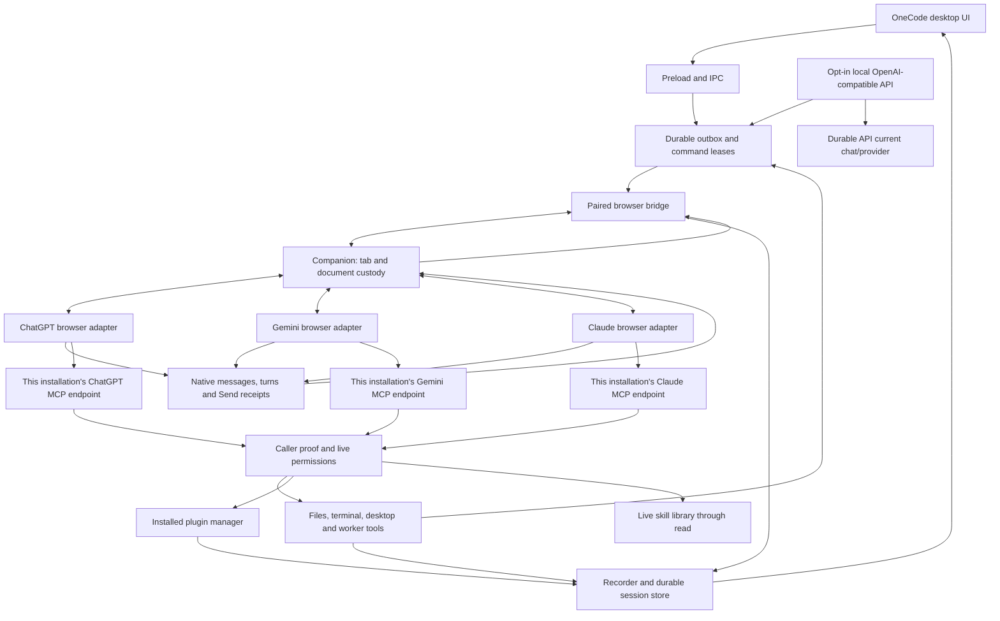

# OneCode architecture

OneCode is a desktop workspace that connects browser AI providers to local projects, tools, plugins, skills and managed chats. The Electron app and Companion share delivery, history, permissions and worker coordination across the registered ChatGPT, Gemini and Claude adapters. The user's provider account runs the model; OneCode supplies local execution and workspace coordination.

This map describes current source ownership. It does not certify that an unreleased repair is installed or accepted in a live browser. Source versions are declared in `package.json`, `src/main/version.ts` and `extension/manifest.json`.

See [browser conversations and local sessions](PROVIDER-SESSIONS.md) for native UUID normalization, fresh openings, parallel families and Compact & Resume identity.

Native capture, durable storage, history/live projection and renderer reconciliation are separate synchronization boundaries. An incomplete desktop view can coexist with a byte-identical native reply already saved in a canonical message shard. Trace exact message/question/turn identity through `extension/content.js`, `session/recorder.ts`, `store.ts`/`read-model.ts`, IPC/history cursor responses and `renderer/chat.ts` before choosing an owner to repair. Preserve authored origin separately from the latest revision sequence, including replies containing native writing/document envelopes; message presence alone is not display parity.

ChatGPT's MAIN-world Fiber projection is intentionally bounded per scan, but that bound is not a history cutoff. The latest user/assistant boundary remains present on every scan for live ownership while a conversation-scoped cursor rotates the remaining slots through older mounted turn groups. The isolated recorder advances that cursor only after the reply still belongs to the same route and navigation epoch. A Companion/recorder revision change fences the helper pair so an already-open page cannot keep an older non-progressive importer after update.

## Data and control flow

Ordered native user history retains `historyBeforeQuestionId` when the same capture proves a later question. The recorder stores the older row normally, while current-question and recovery readers exclude that backfill from task boundaries. Revisions and reconstruction retain this metadata. Exact app-owned Steer receipts remain with delivery until acknowledgement before the transcript observer advances their turn; another human message keeps its independent interruption path.

The browser bridge and MCP listener have separate authentication. Companion pairing alone does not identify an incoming model tool call. Each device owns its own MCP links and local state. Provider endpoints and session claims stay separate even while several chats or provider accounts are active.

## Ownership map

| Area | Primary source owners | Contract |
| --- | --- | --- |
| Product and profiles | `src/main/app-identity.ts`, `index.ts` | OneCode identity, startup, profile migration and shutdown |
| Provider contract | `src/shared/chat-provider.ts`, `src/main/chat-models.ts` | Provider keys, identities, URLs, observed model availability and capabilities |
| Native output admission | `src/shared/native-output.ts`, `src/main/bridge.ts` | Registered provider message/asset/revision contracts, exact conversation envelope and explicit original-export capability |
| Desktop UI | `src/renderer`, `src/preload`, `src/main/ipc.ts` | User actions, settings, workspace/timeline projections; no independent execution authority |
| Remote UI | `src/remote`, `src/main/remote`, `src/main/tunnel/tailscale-serve.ts` | Bundled React UI on private Serve, explicit app actions and safe projections; uses the same outbox and exact native-turn owners as desktop |
| Local OneCode API (Experimental) | `src/main/agent-api.ts`, `config.ts`, `secrets.ts`, `session/input.ts` | Loopback OpenAI-compatible façade and `/new`/`provider`/session controls; persistent encrypted bearer key; reuses the desktop outbox/provider/tool owners rather than executing tools itself |
| Input and browser commands | `session/input.ts`, `bridge.ts`, `extension/background.js`, `content.js` | Durable intent, exact claim/lease, Send authorization and native receipt; no replay after an ambiguous Send |
| ChatGPT adapter | `extension/chatgpt-dom.js`, `fiber.js` | Native composer, conversation, message and tool-call observations |
| Gemini adapter | `extension/gemini-dom.js`, `gemini-markdown.js`, `gemini-routing.js` | Native UI, Markdown, account/document routing and provider-specific binding warm-up |
| Claude adapter | `extension/claude-dom.js`, `claude-models.js`, `claude-native.js` | Native composer, model/effort menus, message receipts, public output and account-limit observations; bounded read-only projection of an exactly owned public file viewer |
| Tool admission | `mcp/server.ts`, `inbound.ts`, `call-context.ts`, `kernel.ts` | Provider-scoped ingress, caller proof, sandbox/permissions and nested-call inheritance |
| Terminal sessions | `codex/unified-exec.ts`, `codex/unified-exec-spool.ts`, `codex/ownership.ts` | Live process reservations, bounded output capture, durable unread completions, exact owner correlation and trusted local quarantine inspection |
| Local capabilities | `gemini/bindings.ts`, `session/local-binding.ts` | Exact local session/task grants; no fabricated provider identity |
| Sessions and history | `session/recorder.ts`, `store.ts`, `correlation.ts` | Canonical session, native turn, tool evidence and process lifetime |
| Workers | `agents.ts`, `bridge.ts`, `worktrees` | Parent family, worker slots, command ACK, verified worktree and finish/revival |
| Plugins | `plugins/manager.ts`, `mcp/plugin-discovery.ts`, `mcp/tools-plugins.ts` | Live installed tool schemas and policy; Core discovery dispatches through the same owner |
| Skills | `skill-library.ts`, `session/skill-prompt.ts`, `session/prompt.ts` | Live catalog, scoped reads and frozen selected instruction revisions |
| Projects and files | `projects.ts`, `sandbox.ts`, `workspace.ts` | Explicit project and root grants; project membership adds no permission |
| Continuation | `session/continuation.ts`, `goal.ts` | Exact same-provider handoff, Goal/Loop and durable objectives |
| Updates | `update.ts`, `update-all.ts`, `resources/updater/windows-update-helper.cjs` | Verified artifacts, install intent, safe shutdown, profile preservation and visible relaunch |
| Release highlights | `renderer/whats-new.ts`, `shared/whats-new.ts`, `ipc.ts` | Bundled installed-version highlights, lastSeenVersion acknowledgement after showing, pending-modal deferral and Settings reopen; no separate installation authority |

Provider keys are closed registry entries, with a corresponding browser registry for the extension. Native UUIDs from different services are not interchangeable: the third adapter stores conversations as `claude:<native UUID>` and strips the namespace only when constructing its native URL. Shared validation, stored-chat opening, Goal/Loop restore, worker identity, schedules and Remote/API projections retain that namespace. Changing a new-chat preference cannot reinterpret an existing task.

`mcp/provider-servers.ts` starts an independent server for every registered provider. A secret path selects one fixed endpoint behind the common tunnel gateway; the UI default cannot retarget an incoming request. Partial startup closes already started endpoints before returning failure. Legacy provider URL tokens and the existing ChatGPT ledger remain compatible.

## Identity and concurrency

Companion composer controls and progress panels retain their extension installation's cleanup namespace. They omit legacy blanket cleanup markers so older Stable and newer Beta observers can share a native browser profile without removing each other's controls in an endless mutation loop. Styling and native-content exclusion classes stay shared; presentation markers never grant provider identity or task authority.

Companion discovery uses the browser runtime's native OS and the app's advertised host platform. A forwarded WSL loopback listener cannot silently become the Windows browser's app, or vice versa. The server also refuses declared foreign-OS pairing and authenticated HTTP actions before changing credentials or processing observations, covering a listener change after discovery. Platform metadata is a routing fence, not caller/task authority; existing origin, bearer, provider and exact receipt checks still apply. Native-platform lookup is bounded, coalesced and retried after transient failure. The current Companion requires positive matching platform evidence; the app retains older-client upgrade access so its shipped Companion can replace them.

OS-backed secret operations have a 15-second response budget. An unanswered native keyring/Keychain call releases its startup or IPC caller without treating the encrypted store as empty or unreadable. Further protected operations fail closed until the original native call settles; late encrypt/decrypt results cannot publish cache, ciphertext or installation authority. The underlying native lifetime remains tracked for bounded shutdown, and a later explicit operation retries after it responds. Linux hard-coded-key fallback remains refused.

Core artifact presentations are durable app progress events owned by the exact session/provider. `artifact begin` records generating state; `create` or the approved-local-file `image`/`video` action publishes the completed inline result. Local MP4/WebM video is limited to 128 MiB, copied into session assets after stable-file checks, and played through bounded chunks with exact presentation/session membership. Desktop and authenticated Remote share that retained asset owner; releasing a player does not delete history. `open` is an explicit workbench presentation, separate from creation. The session store owns retained bytes, reference retirement and cleanup. Presentation images use the same recorded-membership check as other renderer images. This provider-independent path is separate from each adapter's native Canvas and generated-media observations; their exact identity and export-representation contracts are described below.

Interactive artifact documents use short-lived, bounded capabilities: the desktop's `onecode-artifact` protocol or the private remote listener's preview route. Each document has a sandboxed opaque origin, inline artifact scripts/styles and no network, parent bridge, Node, form or child-frame access. The main desktop/remote renderers retain their own strict script policy. Preview handles release documents on replacement/navigation. Background model presentation requests never change the selected desktop chat.

`renderer/artifact-react-preview.ts` transforms JSX/TSX syntax with Sucrase and executes the resulting modules only inside that opaque preview. Build-time bundled React, Tailwind, Lucide and Recharts support local components without a CDN. Imports resolve to the bundled allowlist or artifact-local modules; unknown packages and external services fail visibly with source retained. `scripts/artifact-runtime-plugin.ts` shares the same trusted runtime between Desktop, Remote and local test builds. Mermaid, Markdown, SVG and ordinary HTML continue through the existing preview paths. Native artifact metadata is admitted only by the registered message/surface contract; no hidden response state or invented provider revision supplies output ownership.

A local session is the durable work identity. A provider conversation is its current native frontend, and a turn belongs to an exact authored question/generation. A worker is a member of one verified parent family. A device connector suffix is presentation and selection, never proof of a tool caller.

Existing sessions derive their provider from stored conversation identity. New-chat preference changes cannot reroute an existing chat or worker. Prompt delivery, uploads and browser leases belong to each exact input/document; independent chats must not wait on a global prompt operation. Global update/shutdown barriers may still wait for all active work.

Fresh native openings for the added provider create independently marked `/new` pages. Recovery may retain the page already elected for that exact input, without adopting another empty home, existing conversation or model-catalog helper. Native conversation UUIDs are learned only from accepted delivery and canonical user-question capture. They are namespaced separately from local session IDs and retain message/turn ownership through parallel work and continuation. See [browser conversations and local sessions](PROVIDER-SESSIONS.md).

The experimental OneCode API is a local transport adapter, not a model or tool-execution authority. When enabled it binds only `127.0.0.1`, rejects browser-origin requests, validates the exact loopback Host and a bearer key stored in OS-encrypted secret storage, and bounds request bodies before parsing. When disabled it owns no listener. Its durable state stores only the selected provider/current OneCode session and opening state; the bearer key is never stored there or projected to the renderer/API. `/new` reserves a normal desktop-origin local session, and its first completion uses the existing opening-input transaction so provider binding and Send ownership are established exactly once. Later completion requests use `sendDesktopInput` and canonical recorded finals. Client disconnect ends only the HTTP wait; it cannot prove the admitted provider Send was cancelled and therefore cannot trigger replay.

The API's `/v1/onecode/capabilities` projection is descriptive and recomputed from current owners: the Core surface catalog, effective permissions, enabled desktop/browser methods, plugin manager/tool schemas and live skill library. The projection cannot grant any capability. The provider turn still exercises those features through the ordinary MCP admission/sandbox/permission paths. The experimental adapter currently admits one real provider completion at a time while known IDE housekeeping requests are handled locally; IDE project/thread mappings keep unrelated client chats out of the same durable OneCode session.

Unified terminal sessions retain a live reservation until exit output is closed and the unread completion is durably committed. A bounded close wait seals any still-open inherited stream as interrupted and exposes that state with its retained bytes. Startup validates the durable spool before desktop process admission; a missing, corrupt or unwritable spool keeps terminal admission closed until initialization succeeds. Storage refusals may project only a bounded path-free cause (for example access denied, full, busy/locked, read-only or I/O error); raw filesystem strings, host paths and retained output are never used as model-facing diagnostics. Completed unread output survives manager restart and is retired only after acknowledged delivery or an explicit trusted local discard. The ownership module exposes quarantine inventory, read, lossless export and discard helpers for desktop wiring; these helpers are not model tools and are not available to Remote callers.

Worker delivery and liveness share one provider-independent command lifecycle. A native Send acknowledgement commits delivery; observing the worker's new turn retires the liveness clock while preserving the exact durable delivery receipt. Provider authorization adapters read that receipt or the same durably committed broker delivery while settlement is in flight. Retiring a transport must not revoke the freshly delivered task, and observing activity alone must never authorize an unacknowledged Send. `test/worker-delivery-receipt.test.ts` runs both event orders for every registered provider and requires an explicit adapter when adding one.

Browser adapters retain the existing draft lease through their own native preparation steps. Gemini's accepted tool-free warm-up can appear before its editor clears. Only that exact warm-up text may remain during the bounded native-cleanup wait; an empty editor is required before restoring the task. The warm-up may also replace the fresh editor; after its exact conversation and empty replacement editor are confirmed, restoring the unchanged task transfers the existing command draft lease before authorization. A human draft is preserved and aborts the bootstrap. This preparation does not activate a worker capability or replay a task Send. ChatGPT has no Gemini warm-up; its native composer and pre-Send ownership checks remain adapter-specific.

Recovery owns each adapter and recorder as a pair. It probes the exact requested document before injection and preserves a healthy pair, refreshing ChatGPT's independent MAIN-world helper when needed. Concurrent repair attempts share one per-tab flight; a different document rechecks its own custody afterward. Replacing an adapter alone can erase callbacks still owned by a retained recorder. The recorder protocol revision fences replacement of older pairs; both provider repair paths and overlapping/replaced documents have regression coverage.

Each recorder captures its adapter instance at creation. A late static adapter/content injection may replace the global while retaining the healthy recorder; it cannot redirect that recorder away from its original binding resolver, claims and draft leases. Worker and Resume bootstrap regressions cover this injection order.

A reconciled recovery offer may replace an older pre-redeem recovery waiter or same-chat URL marker. It cannot replace a fresh bootstrap or a command that has started redemption. This retires stale browser waiting state without replaying a Send or touching a human draft.

Model Refresh prefers the selected native page on both providers. Gemini account routing filters out other account prefixes before discovery; a result from an account changed during inspection is rejected. Native locked or denied choices are excluded. Gemini's collapsed lane caption does not prove a versioned mode ID, so it projects the provider's current-model option; an open native menu can prove the selected ID. The desktop offers one Automatic choice rather than duplicating that compatibility option.

An observed model may carry its native Chat/Work surface. This is selection metadata, never account availability or tool authority. Saved preferences bind it to the exact provider and model; outbox entries, workers and continuations freeze it before publication. New ChatGPT chats default to Chat, while an explicit observed Work choice activates that native surface under the existing empty-draft, document and claim guards. A unified native picker without separate modes can still prove the exact requested model. Discovery restores the original model and effort; Gemini observes Thinking levels per model and rechecks the requested pair after fresh-chat warm-up.

Fresh-chat model preparation freezes two different facts at durable admission: the provider's exact native model identifier and, when positively observed, that choice's display identity. The identifier remains authoritative. If the provider rotates that opaque identifier before the fresh page opens, an adapter may use the frozen display identity only to locate one unique, currently available native choice and must still prove the resulting model/effort on that exact composer. Ambiguous labels, denied choices and a genuinely different model remain refusals. The fallback is carried in the bridge contract rather than reconstructed from whatever catalog happens to be current at redemption time.

Model catalogs are owned independently per provider and native discovery nonce. Current/legacy grouping, descriptions, effort labels and usage-cost hints are bounded observed metadata. Upgrade/disabled rows are excluded by the native adapter; labels from an account's menu may be opaque identifiers and are never presented as invented execution slugs. Exact choices must be re-proved on the destination page. Previously observed catalog metadata supplies no subscription or tool authority.

The added adapter refreshes the native root and legacy model lists without cycling through models or changing effort. It reads only the currently selected model's reasoning control. `effortsObserved:false` explicitly distinguishes an unread menu from an observed absent control; controls are never copied onto other models. Optional `reasoningControl` distinguishes native labelled levels from a binary switch, whose checked snapshot must be positively observed. Binary on/off uses the existing high/none values internally; blank intent retains current settings and never defaults to Off. Desktop, settings and Remote hide unknown or absent control panels. Only an explicit UI model choice supplies optional `ChatModelDiscoveryRequest.model`, through the same nonce owner, IPC and Remote action. That bounded inspection uses its own empty discovery helper and selects just the requested model. A newer target supersedes the old nonce, and stale results cannot replace it. Saved exact efforts with unknown availability remain requests for native verification, not advertised choices or permission to skip pre-Send proof.

Account quotas are typed `chat_error.usageLimit` observations, separate from a history-load `retryAt`. Desktop, Remote and local control projections preserve the observed kind and reset text/deadline. `provider-usage-limit-notifications.ts` emits one background notification per blocked episode, while unknown deadlines remain unknown. Neither a displayed reset nor elapsed time retries an uncertain input or tool action.

Refreshing native approval policy must preserve an existing task capability, including a dormant command grant. A policy read cannot replace the key already carried in the authored task, remove its Send-ACK requirement, or revive a cancelled command. The worker command binding tests exercise policy reads on both sides of ACK and after cancellation.

New outbox entries capture their provider when enqueued, before asynchronous preparation. Binding an opening to a foreign provider is rejected before changing its session or outbox identity. The provider picker is not routing authority for work already queued.

Bridge discovery and live browser presence are separate owners. A retained bearer may ask `/hello` whether the existing bridge credential matches, without pairing, publishing presence or reading work. Escaping an incompatible cached port requires that same credential's positive ownership proof at the compatible endpoint; a protocol-compatible foreign installation cannot borrow it. A legacy endpoint without this optional proof remains bound conservatively to its retained port. Unauthenticated or incompatible profile announcements cannot erase an authenticated external browser's record or replace the live version/build used for update presentation. Native Chat mode readiness also remains separate from model availability: switching from Work to an idle, owned Chat composer does not require a model picker, while an exact model request still requires native selection proof.

Desktop and remote hide the new-chat provider switch as soon as the first input is submitted. Provider-scoped model observations replace the visible catalog on switching; a prior provider's edited model or default cannot become a new provider's Send choice. Existing chats derive provider from their stored conversation or opening outbox.

Remote mode configures its dedicated private Serve route from Settings. Its remote-only key lives in OS-encrypted secret storage; the copied URL retains its fragment so a bookmark can reopen the same installation after a restart or update. The fragment never reaches HTTP logs or referrers. Browsers exchange it for independent revocable tokens backed by a durable installation-bound hash ledger. Ordinary restart, inactivity and transport outages preserve this authority. Explicit browser removal, Remote disablement and link rotation revoke it; an old saved browser token cannot silently re-enroll through a bookmark. Explicit Reconnect can request new admission. Safe reads resume independently with bounded concurrency; uncertain POST actions never automatically replay. The same port is reused on restart; a replaced route fails closed instead of silently moving the bookmark. The trusted desktop offers an explicit Refresh link action for that conflict, choosing a new free private port while preserving the conflicting route. The HTTP service validates its exact private origin and route custody, exposes only explicit actions and projections, and never forwards arbitrary IPC, provider credentials or connector URLs. Durable operation receipts prevent replay after an uncertain reply. Serve and provider MCP Funnel serialize routing mutations while retaining separate port custody.

An accepted Gemini input immediately re-observes and flushes its exact native question after ACK. Escaped provider readback may be recognized by the Send verifier before the ordinary recorder can match composer text; the ACK supplies the frozen native message identity to that existing observer. A hidden page timer is not a prerequisite for publishing the input's turn. Changed text, message, route or lifetime cannot spend that receipt.

An exact native Send plus committed application ACK can publish its frozen question and open its turn while the browser source is still pending, including a mounted but unreadable bubble. Rendered presence is not a veto on this independent receipt. The same conversation, document epoch, receipt lifetime and new-generation/answer checks remain; the receipt is spent once and never resends the task. Later readable history does not open a second turn.

If native whitespace changes make a length-framed context unreadable, the exact accepted message and full task comparison can recover the original composer source from that same Send receipt. The observer records this question before opening its turn. Generation recovery cannot open a turn for a question that has neither been published nor acknowledged as a durable user anchor; otherwise it would inherit the previous question, including an older permission reply.

Gemini may render approval decisions as `Allow`/`Deny` user-query rows. Only an exact observed native decision click can classify such a row as a control exchange within the original task. Companion clicks register before dispatch; trusted manual clicks register at capture on the exact recognized decision controls. The adapter observes the original card's decision mutations so disabling and removing it in one native render does not lose that receipt. Unproved, expired, edited or foreign replies remain ordinary authored messages and cannot renew task authorization. Auto-approval labels include actual published titles only for tools enabled on that exact connector.

When available, an exactly joined native request ID can identify a ChatGPT call. The local-binding owner also provides independent installation-bound ChatGPT and Claude task capabilities, checked against the exact outbox, worker-command or Goal receipt and provider. The added adapter requires that exact capability even when unattributed calls are enabled. Gemini retains its own attachment/input/command flow. All routes retain permissions, Block/Trust and exact parent checks. Native RPC IDs, current tabs and recent activity cannot supply missing ownership.

Credentials belong to the installation and provider endpoint that issued them. They are consumed before recording tool arguments and never enter public diagnostics. Independent durable provider ledgers retain hash-only grants without a clock expiry. Each use still requires the original exact input/command, accepted question, attachment and active task proof. A cancelled, rebound, blocked, superseded or foreign grant fails before execution. Missing, corrupt or wrong-installation storage fails closed; transient reads can retry without replacing the ledger. Tool schemas or connector names cannot repair a missing caller.

An unsent ChatGPT claim may reuse frozen prompt bytes only while their embedded durable grant still matches that exact claim. Replacing the preparing document revalidates its authorization before Send, preserving the authored task and attachments. Authorized or ambiguous sends cannot enter this preparation path. Both adapters retain bounded native receipt waits for individual admission attempts; waiting never substitutes for the exact accepted question and turn or destroys the original durable intent.

After the desktop input's exact ACK, both adapters promote its witnessed native message into the ordinary turn observer, including Markdown-escaped first messages. The submitted-text check excludes native connector chips in the same way as the captured Send receipt. The original history/adoption gate still resolves before journaling; rejected ACKs and replaced receipt, route or document cannot spend this promotion.

The accepted app-owned task retains its original length-framed source when a rich editor flattens paragraph separators. The exact ACK and full-task comparison own this recovery, within the same native receipt window. Releasing the desktop input slot queues one observation of that same still-current receipt after native Send cleanup; it cannot resend text.

ChatGPT upload custody retains only new remove controls created during the exclusive upload. A unique native numeric collision rename may bind before the first observation only with a retained unchanged draft. Completion must pass that draft's trusted-edit fence as well as file-count and Send-readiness checks. Another basename/extension, an extra file or a changed task cannot acquire the upload lease.

The native Send button's click and its form submission are one transaction. The exact button/form submission consumes the click's receipt once; a cleared editor with a lingering attachment tile cannot replace it with an attachment-only receipt. The current ChatGPT shell's search-unit question inside a shell exchange is read once by its native message ID and role, independent of positional layout keys.

A native search wrapper and nested legacy slot can describe the same question. Identified nested slots are resolved once; a nested positional view with no independent identity cannot make that question ambiguous. Distinct questions and unrelated duplicate slots remain refused. A short answer's explicit assistant Markdown wrapper also supplies the assistant section when the native search/agent-start wrapper is absent. Redacted layout and lifecycle counters report structural counts and ownership/completion booleans without prompt text, credentials or provider URLs.

Fresh ChatGPT commands can acknowledge the exact native Send POST before the readable question mounts, using the same receipt as ordinary desktop input. The committed command retires its lease normally; the accepted receipt and unchanged document still own the destination checkpoint and journal release afterward. An accepted question's frozen submitted bytes enter ordinary history before its turn when the native question is not yet readable. Mounted source/history rows cannot become that question by anchor absence. This preserves first-tool attribution without waiting for a renderer scan that can itself wait for that tool.

Resume credentials belong to the continuation's provider and original durable session, independent of the new-chat preference. ChatGPT checks the committed command, exact destination question and first live successor turn. Bootstrap Send reports its already-proved destination question to the existing continuation checkpoint immediately after ACK, before waiting for another native scan or picker refresh. This avoids making the first tool wait for a scan that can itself be waiting on that tool. Releasing the journal gate immediately re-observes the successor, including a response that finished during rebind.

A native completed turn stops the displayed Active indicator when no newer work exists. The underlying recovery watch may remain while final history finishes recording; that watch is not a running answer. Exact running tools and a newer live turn retain their own activity projection.

## Plugins, skills and provider features

OneCode 0.4.0 stages one Core connector per provider/installation for local files, terminal, permitted desktop/browser tools, managed skills and the external plugin gateway. Legacy surface endpoints remain compatible, but new setup and tool-change notices use Core. Capabilities and request-scoped identity continue to gate each action; consolidating discovery adds no permission.

Core and legacy Desktop register the same desktop/browser owners and schemas. Core code mode supplies the same Windows `sky` aliases. Native connector refresh accepts the expanded Core catalog on both sides of the bridge while retaining exact app/route identity, schema and size guards. A cached provider schema can discover newly permitted built-in methods through the stable Core `plugins` gateway. This changes discovery, not permissions or caller authority.

Core `skills` imports an approved file/folder into the same managed library the Skills page reads and returns the live catalog for verification. Core `plugins` can list installed integrations and install a requested source through the existing plugin manager under Command and Create permissions. Read-only mode refuses installation. The bundled native backend skills remain separate from user-created local task skills. The added adapter uses native skill name `onecode` and ZIP root `onecode/SKILL.md`; implementation provider keys and API routing aliases remain unchanged.

Artifact schemas expose their action fields at the object root and retain strict conditional validation. A create can inherit its title only from its exact pending presentation. `patch` and `present` move the same inline card to the latest response; `open` explicitly requests the workbench. Preview defaults to responsive CSS pixels and retains fixed desktop/phone simulations. Opaque-origin documents get bounded document-local storage only when native storage is inaccessible; this grants no host storage, network or persistent origin.

Core always exposes local plugin discovery through `plugins` with `action: list`. Its live catalog comes from the installed plugin manager. Existing chats can use Core code mode when a provider cached an older direct-tool list. Follow-up preparation includes live discovery guidance and the configured connector name. This works through each registered provider's existing owners; marketplace search or a new chat is not the normal discovery step.

Account-enabled connectors are configured and enabled once in provider setup. Normal task, worker, Goal and Resume delivery does not reopen or toggle that connector, insert a per-message @ mention, or gate Send on its DOM menu state. Actual MCP availability and local task authority remain separate: an unavailable endpoint reports its real failure, while every local call still requires its original capability, native question/turn, permissions and parent-family proof. Other adapters keep their provider-specific native connector-selection mechanism.

Local skills are provider-independent files and metadata. The virtual `/skills/.catalog.json` read reflects the live library within the caller's validated scope. Reading a skill body and freezing a selected revision are separate actions. Optional native skills are separate adapter features; Setup exports their public Markdown/ZIP packages without installing remotely or including credentials. The user opt-in does not prove a native skill loaded. When enabled, the task owner freezes compact and full-guidance variants carrying the same exact capability, authored task and selected instructions. A confirmed native slash selection/token permits the compact variant; a bounded unavailable lookup may use only its prepared full fallback under unchanged draft/document custody. With the opt-in off, ordinary Core/schema and live task guidance remains. No variant changes permissions, native identity or uncertain-send policy.

Computer use is a reviewed CUA Driver recipe in the ordinary plugin manager. It discovers existing official installations outside a stale desktop PATH and connects an MCP proxy to the daemon's explicit reported endpoint. It never replaces an existing driver or changes its permission mode. An explicit install downloads a checksum-pinned upstream installer only when the driver is absent, then imports the complete upstream skill through the normal GitHub skill owner. Driver binaries and skill files are not vendored into this repository. Disconnecting OneCode closes its proxy, preserving the shared daemon. Installing the Computer use recommendation follows this same plugin setup.

A native stopped-turn observation reconciles a worker through the existing durable finish barrier immediately. It frees the slot while preserving the chat and unread queue, reports that work may be incomplete, and does not automatically wake queued work after an explicit Stop. An ACK for a stop click alone is not proof that the provider stopped; a historical stop cannot close a newer turn.

Automatic compaction reads tool-result receipts from every exactly stamped section of its logical source answer. A response split across native sections has no single Fiber descriptor. Missing or conflicting receipts still prevent Stop and Send. A failed pre-Send barrier records its reason and releases that ticket; browser pickup cannot renew an exhausted retry budget. Once dispatch is uncertain, the original transaction retains custody and is never resent on a timer.

Compaction checkpoints derive their provider from the browser's validated current source URL. ChatGPT carries a Fiber-question document; Gemini carries a native-question document and its account path. The bridge validates that receipt against the provider's conversation shape before permitting Send. Recorder protocol revisions replace retained older content closures when compaction behavior changes.

Every provider's compaction prompt requests a complete Markdown reply without tool calls. The recorder's exact source question, single completed generation, final message and settled tool state own capture and local storage; partial or interrupted prose cannot open a successor. Gemini retains its browser/document/account custody checks. The older scoped `save_handoff` tool remains compatible with already-issued prompts, but is no longer required by current compaction.

Only a page's handoff-capture reply may consume its replacement placement. The compatibility Gemini MCP `save_handoff` response cannot open a browser tab, so its capture leaves that offer with the ordinary browser status owner. A foreign browser cannot collect it, and the owning browser can collect it only once.

Gemini's replacement command carries its verified tool-free warm-up conversation at the destination checkpoints. ChatGPT still requests these checkpoints from its fresh, id-less route. Both pass the bridge's existing exact document and current route checks. A preparation failure before requesting destination dispatch fails the command visibly; after that request, even a lost reply retains custody because Send may have been armed.

The controlled Gemini warm-up can transfer its existing edit transition once when the native fresh editor is replaced before Send. The old host must be disconnected, the replacement must contain exactly the staged warm-up or the preceding proved-empty state, and its opening/command, route and attachments must still match. Empty-state transfer additionally requires disabled Send and no attachments; native paragraph/caret readiness remains mandatory. Trusted edits revoke the transition, and a different draft is preserved. This does not arm or replay the real task.

Context counts are local recorder estimates. The configured reference controls presentation and the automatic-compaction trigger; exceeding it cannot revoke a caller, stop a turn, or block authored input. A history-load HTTP 429 is separate transport evidence. Its retry deadline can include OneCode's own conservative backoff, so the interface must not attribute that deadline to the model or describe it as the provider's context capacity.

Native provider capabilities remain explicit: model selection, native projects, approval layouts, file uploads and generated-media export differ. Gemini generated images are admitted only through their exact response and native declared attachment index. The adapter captures already-loaded pixels and exports a rendered PNG; it does not claim the provider's separate full-size original download. Generated video uses the exact response-scoped native singleton, MIME, download control and rendered download URL. Ambiguous resources and ordinary embedded media are refused.

ChatGPT PNG file cards have a separate exact public file reference: canonical assistant message, sandbox path and basename. The native file download and preview buttons are leased to that reference. An automatic preview capture opens once only with no existing viewer or competing input, binds witnessed local-viewer pixels through its temporary lease, and closes only the unchanged owned viewer. Trusted user input revokes capture and preserves the touched viewer. A temporary viewer path never becomes provider identity. Resident history refresh updates existing canonical rows without admitting a new page or moving the live cursor.

Native output ingestion uses one normalized image/video/artifact pipeline. `CHAT_PROVIDER_DEFINITIONS` owns provider keys and routing; `NATIVE_OUTPUT_ADAPTERS` requires an explicit identity, export-representation and snapshot-surface contract for each key. The bridge validates observations against their conversation envelope. Gemini requires its exact rendered assistant identity and an explicit provider stamp; document-position fallbacks and foreign conversations are refused. Companion transfer support is independent of the default provider for new chats.

Gemini's rendered video download blocks page-origin fetches. A browser-only relay has narrowly scoped permission for the witnessed native download host. It accepts only an app-issued export nonce for the exact elected tab/document/message/resource, rechecks page ownership around every awaited chunk, and sends only bounded acknowledged bytes to the existing app export owner. Signed URLs remain inside the browser companion and never enter app RPCs, history or tool results. The long stream does not hold the per-tab mutation queue, so observations, Stop and steering receipts continue normally. The app validates MP4/WebM structure and publishes exclusively to the authorized destination.

Native HTML Canvas snapshots are distinct from provider-native artifact revisions. The adapter temporarily selects the native Code view under a route/document/user-interaction guard, reads Monaco's complete source only from the editor mounted inside that exact response, and restores Preview when its lease is unchanged. The native editor's transient URI/version is never treated as a Gemini resource or revision id. OneCode retains response-scoped source snapshots with local immutable revisions, one Generating-to-ready inline anchor, and no automatic workbench opening. Ordinary code fences are never promoted. Replays cannot overwrite local edits. Unsupported or oversized source fails the presentation; unknown or incomplete source remains unclaimed. Future providers register their own exact surface and export contracts without adding provider-specific chat UI branches.

## Reading and validation

An explicit authored Send can launch its marked provider URL when a browser process exists but its companion wake channel is unavailable. The queued input is rechecked after the process probe; collected, cancelled and shutdown work cannot launch it. Concurrent sends share that startup attempt. Automatic recovery and discovery retain their process-absence requirement.

After connector readiness, an already connected companion receives a fresh work notification. A marked new Gemini input with no open account context may open the normal native home once; the observed page then selects the account for preparation. This exception cannot choose between multiple live accounts or reopen an existing conversation with unknown account ownership.

A Gemini reply that stalls before its first local tool call can earn one page refresh after ten minutes without meaningful output (longer deliberate-thinking windows remain intact). The existing input owner must prove the exact committed native Send, recorded question and current open generation. The ordinary assistant-error claim and per-question budget own the action; fresh output, a newer question, Stop, completion or disabled continuation withdraws an unclaimed refresh. This refresh cannot authorize Stop, Continue or resend the task. Recognized native Gemini transport alerts are recoverable; account, quota and unknown alerts remain blocking.

Tailscale startup waits for transient daemon/network states without reopening sign-in. Public ingress races Cloudflare and Google DNS over HTTPS, pins only global addresses with the original TLS hostname, and requires the exact connector metadata and MCP initialize reply. A framed initialize SSE reply completes the check while its stream remains open. Read-only checks retry against the retained route; they never replay route mutations. Unrelated settings writes preserve the config owner's tunnel incarnation so an accepted post-update connection can finish; real tunnel edits still invalidate it.

Public TLS failure retains the exact native route but withdraws Connected while checks continue. On Windows the trusted desktop can explicitly request Repair public connection. The live Tailscale adapter rechecks node and route custody, the connection owner refuses running tool calls or a changed transport, and tailscale-repair.ts requests Windows consent to restart only the system Tailscale service. Concurrent requests share one restart. Polling never launches it, cancelled repairs are not replayed, and pre-repair probe results cannot establish post-repair readiness. Existing routes, account state, private Remote links and profile data are preserved; ordinary public DNS/HTTPS/MCP checks own recovery.

`browser.ts` owns installed-browser resolution for setup and app-authored launches. Windows checks the selected family's normal channel paths, PATH, per-user/machine App Paths and StartMenuInternet registrations, and matching running executable paths on any drive. Registration arguments are discarded and another family is never a fallback. An explicit local executable picker retains per-family paths through the config owner. Setup saves the chosen family before sign-in and passes that same family to the launch IPC; pending or rejected saves cannot open a previous selection.

Desktop Compact pickup acknowledges an exact live document before fetching its activity feed. The browser's IPC reply deadline must not reload that same document while a delayed feed response starts the handoff Send. An owner already between dispatch authorization and native acceptance retains custody. Actual Send, accepted question, saved Markdown and successor commit remain separate checkpoints for every provider; one provider's pending checkpoint cannot serialize another's.

An exactly matching route that Chrome still marks loading can refuse a checkpoint before forwarding it to the app. Source checkpoints and successor authorization both use the same bounded readiness wait for that explicit unforwarded refusal, including Gemini's named warm-up conversation. A changed document, foreign route, lost response or uncertain dispatch cannot use this retry. The compact status remains Preparing until durable source dispatch evidence exists.

Native approval policy reads live declarations from the requesting provider's endpoint explicitly. The UI's new-chat selector is only a presentation default and cannot select another existing chat's tools. Adapter-only tools must not be advertised by an endpoint that cannot validate their admission proof.

Gemini history can hydrate a previously proved approval reply before its source exchange. The adapter keeps that exact scoped reply provisional while its unchanged decision and durable click receipt are known but the source node is absent. It cannot become a newly authored question merely through partial hydration. Unreceipted instructions and edited reply text remain visible. Native repair readiness also waits for the receipt store; this neither grants execution nor reclassifies already recorded history.

Session history remains in the canonical local store: message shards, append-only tool events and checksum-verified handoff Markdown. Core `read` exposes read-only `/sessions/.catalog.json`, per-session `history.md`, paged history and saved handoff paths from that store. It requires live Read files permission, omits transport authorization and masks recognizable credentials. It never exposes the profile directory or grants execution authority from historical instructions. Registered providers discover these paths through the same schema and opening guidance.

Start with this map and `AGENTS.md`; then inspect the owner of the behavior being changed. `docs/MULTI-PROVIDER-COMPATIBILITY.md` records the adapter contract and remaining provider assumptions. `docs/UPSTREAM-ARCHITECTURE.md` preserves the historical upstream design and is not the current product map.

Validate source, a freshly built package, the installed app and the live native browser separately. Current repair acceptance must include independent same-provider chats, simultaneous ChatGPT/Gemini work, uploads, exact worker parent attribution, local plugin/skill discovery in existing chats, and Windows install/relaunch with the normal history preserved. Do not claim acceptance from source tests alone.

Late ChatGPT commentary is placed with its exact already-recorded native assistant message or consistently owned connector requests from the same native response descriptor. Conflicting response owners remain unclaimed, and a local turn cannot claim two native responses. This history placement cannot authorize a tool or mark a settled response as new activity.

Code mode routes image blocks from an explicitly printed native MCP result through the existing image emitter, validation and output budgets. It prints metadata with image placeholders instead of serialized base64. It never forwards unprinted tool results or parses arbitrary strings as images; dispatched actions retain their lifetime on output failure.

Remote project groups come from the local project owner and expose only IDs, names and colors. New-chat sends validate the current project and carry that association through the shared outbox/workspace owner; existing chats cannot be reassigned by a send. Project composers retain independent drafts, attachments, plans and unresolved receipts. Membership never grants an additional filesystem permission.

## Recurring local checks

`chat-schedules.ts` owns a strictly validated durable interval ledger. Core `automations` resolves the exact caller session and endpoint provider before creating, listing or changing a schedule. Existing chats can discover the tool through the live Core plugin gateway. Provider-native cloud Monitoring cards are not imported as local schedules. Both provider opening guidance and optional native skills describe the local feature.

Each due run durably reserves its original input UUID and message before admission to the ordinary outbox. Delivery waits for the existing turn and retains the same session/provider, Block/Trust, permissions, exclusive claim and native Send ACK guards. A restart reconciles the original outbox receipt; it never replays an ambiguous Send. Only one unresolved message is pending for each schedule; missed intervals coalesce to one message without shifting the original cadence. The app must remain running, the PC awake and the provider signed in. Queued, sent and completed work are distinct facts. Desktop and authenticated remote settings project the same owner and can cancel its pending input.

Application hotfix updates share update.ts, update-bootstrap.ts and the detached Windows helper with ordinary installation. update-hotfix.ts verifies and stages a complete allowed-resource snapshot. resources/updater/hotfix-contract.cjs supplies the packaging/runtime path and inventory contract. The after-pack hook fingerprints immutable native resources and the exact Electron version; a matching release capsule can update app.asar, Companion, skills and updater helpers without replacing Electron or native binaries. Explicit install intent and canonical work/shutdown fences still own activation. The helper verifies actual native files, preserves rollback copies and requires the expected application version plus a stable visible window. It restores a failed snapshot only while no successor is running; an unconfirmed running app is never terminated or overwritten.

Windows hotfix manifests can embed a verified complete-base descriptor. If the installed runtime is incompatible or cannot be patched directly, update.ts checks that descriptor against the exact base release's checksum list, downloads both artifacts and stages a single version-bound composite intent. Download progress follows received bytes across the complete plan. update-bootstrap.ts persists schema3 outside the install; the helper verifies the patch before base execution, installs the full release with intermediate relaunch suppressed, verifies its version/registration/native inventory, applies the patch and launches only the final app. Failed patch rollback restores that new base's application files, not the old native runtime. Full installer downloads use their selected tag's feed, and full release builds retain all hotfix commits already merged into `release`.

Linux uses a self-contained immutable bootstrap and a verified per-profile application layer with startup rollback. Compatible AppImage and positively identified DEB installations can explicitly activate user-space capsules. Incompatible AppImage updates replace only the proven original portable file; full DEB/native changes remain package-manager-owned. Bootstrap proves the mounted AppImage executable/resources and original file identity, or exact dpkg ownership. Other packaged directory builds use isolated QA profiles and disable production updates. Explicit profile overrides remain available. Bootstrap changes require a complete new Linux base. `native-package.ts` resolves a selected Linux layer's native packages from that executing base's `resources/app.asar`, including its unpacked package files. Renderer, preload and mutable application resources follow the selected layer; native packages cannot fall back to a layer or another installation.

Update readiness projects local tool processes, provider work, browser actions and terminal panels separately. The trusted desktop's Background work dialog lists all local process owners and offers incarnation-bound individual Stop controls. Exited unread output does not count as running work. Update now retains exact version/digest/installation checks and uses ordinary shutdown to stop owned work and seal output; installation handoff is skipped if any preceding shutdown phase fails or times out. Ordinary Quit never installs a staged artifact.

Explicit chat selection asks the bridge to load that session's exact provider tab. A generation-fenced readiness projection reports loading, history cooldown or refusal without repeated opens from polling. Recovery retains reload receipts and history backoff outside the navigated page. A pending Stop requires native terminal evidence; a guarded hung owned tab can be closed once, reopened for its original chat, rechecked and stopped before reload and the original continuation. Human drafts, attachments, active tools, changed routes and uncertain Send remain fences.

Message history keeps chronological origin separate from its latest content sequence. Late revisions to an earlier message remain reachable by incremental desktop/Remote cursors. Active revision evidence prevents a historical stale snapshot from overwriting the current body while still permitting a proved active shortening. Periodic turn rotation defaults to off; existing explicit choices are preserved. Runtime diagnostics expose event-loop delay, memory, suspend/resume and aggregate terminal pressure without granting recovery or execution authority.

The after-pack hook records the actual full release's baseVersion in runtime.json. Application capsules cannot replace that file, so APP_VERSION never impersonates an installed full base. A required newer base, or a legacy missing receipt, forces the verified full-base path even when native hashes match. The desktop selector and detached helper share this compatibility rule.

Steering receipt baselines use the previous native user-message ID even while its source text is unreadable; the send owner and observer must not disagree based on text visibility. Current exact acknowledged ChatGPT inputs can earn one question-budgeted refresh after the normal 90-second silence window before first tool use, through the same authored-input repair owner as Gemini. Gemini retains its ten-minute first-response floor; Pro and deliberate-effort windows remain. A refresh does not itself earn Stop, Continue or another Send. Active progress, permission/Stop, running-tool and replaced-source fences are rechecked at claim.

Committed Compact & Resume transactions remain durable task receipts. Their waiting deadlines and unfinished recovery budget cannot expire the successor's local tool authorization. Retention grants no execution by itself: admission still validates the current attachment, exact native question, original generation and committed command receipt.

Shutdown settles its exact process termination attempts before checking the same WSL custody store for remaining obligations. Concurrent completion capture may already have proved a token empty and retired it; its stale termination result cannot recreate an obligation. Retained tokens, a changed store and unconfirmed Windows leader exits still refuse installation handoff.

Browser repair dispatch uses bounded transient flights per conversation, leaving shared input pickup available to independent chats. The same document cannot receive input or be reused while its repair runs. Main's existing token and native document checks retain mutation authority; connection changes withdraw navigation. Successful unscoped installed-plugin inventory remains recorded as unattributed metadata and does not justify reloading an active conversation.

Explicit steering uses the controls owner's durable unfinished turn separately from its expiring activity display. Expiry cannot prove native completion or revoke the user's exact Stop request. Admission and Stop redemption recheck the conversation/turn; native end evidence releases the same outbox row. Historical unfinished turns do not become Working merely through this projection.

A native Stop can replace a mounted reasoning body with a collapsed stopped-thinking disclosure. Only a fresh transition witnessed after the authorized Stop, inside the same exact response and under unchanged question, conversation and idle-composer guards, can supply that terminal receipt. Historical captions, assistant prose, foreign questions and a still-busy native page do not settle it. Local process and poll lifetime remain separate.

Explicit Steer can also witness its native primary Stop changing to the enabled Voice control after its authorized click, in the same unchanged editor and form. A pre-existing idle page, ambiguous or disabled control, changed question, draft, attachment, approval or replacement form supplies no such receipt. This path is unavailable to automatic Continue and Goal/Loop; their existing terminal-proof rules remain in force.

The outbox's live input policy owns offer, claim and final Send admission. A released Steer or an explicit user follow-up (Send or After this turn) after its confirmed native completion may proceed while an exact local request remains open. Cached Companion tool counts are display data and cannot veto that eligible input. Accepted immediate messages held by the live policy retain their original outbox row and resume their pickup deadline only after eligibility returns. Generated checkpoints, schedules and automatic continuation retain settled-work barriers, and the native document still guards generation, changed questions and user drafts. An exact native interrupted-response marker can confirm continuation Stop without a final assistant message; the redeemed command's question must still match. Steer preserves local process ownership, incarnation and output; explicit user Stop retains its separate exact-session termination path.

MCP tool exchanges use streaming responses with ten-second keepalive comments in both supported protocol eras. Discovery retains its existing format. Authentication precedes handler selection, and each request still dispatches once. The provider gateway and Funnel relay propagate a truncated upstream stream as an interrupted downstream response, with no automatic replay. Bounded response-closure diagnostics record only the surface and elapsed time.

Recovery checks read the exact chat's current running-tool count rather than treating the activity loop's cached count as authority. An unavailable read refuses the repair. Explicit Stop can redeem the exact latest question before an assistant section mounts; native termination remains a separate checkpoint. Desktop and Remote use the same startup/input owners on Windows and Linux. The startup budget includes the initial connection lifecycle, and a later explicit queued Send can wake a browser whose earlier successful OS launch never restored its Companion channel. Neither change replays an authorized Send. Trusted desktop activation of a recorded ChatGPT sandbox file retains exact session/message membership and a one-shot broker claim independently of model screen/control permissions; it never attaches a debugger.

Recoverable transport notices and silence warnings cannot terminalize a task. Native completion, true failure, explicit Stop and supersession retain the turn boundary. Fresh activity feeds advance the watchdog only for running tools on the exact recorded turn. Input offers restore a missing observer in their elected tab immediately through the existing restoration owner; neither restoration nor document replacement refunds Send authority. Composer draft, insertion and receipt readers exclude native connector chips consistently while retaining authored text, attachment and trusted-edit fences.

Failed automatic-input notices expire from presentation after thirty minutes or an explicit dismissal. The outbox retains the original failure timestamp, dismissal and delivery proof across restart. Dismissing a terminal notice does not cancel or revoke a possibly delivered task, remove its receipt or authorize replay. Desktop and Remote read this same presentation rule.

Steer retains its native Stop attempt only after the adapter actually clicks Stop. Pending approvals cannot spend that attempt or justify a hung-page refresh. Destructive navigation checks both the exact live local-request owner and fresh native approval/draft/document/connection guards. The one-shot fallback reloads the same tab, avoiding a closed-page gap when automatic tab recovery is off; the same outbox still waits for native terminal proof. The durable legacy steerClosedOnce field retains that navigation receipt. Restored Resume command custody uses the continuation owner's canonical base64url token format, and bounded checkpoint diagnostics expose pending receipt stages without task data.

Native model-picker readback coalesces dirty observer retries onto an event-loop task so MAIN ownership metadata cannot recursively starve rendering, cancellation or deadlines. The initial read and exact model/account proof remain unchanged. A terminal failed handoff is historical presentation: a later positively identified native question clears its old composer badge without deleting the transaction or its saved summary. Bootstrap model failures retain bounded adapter checkpoint names in the existing command ACK diagnostics.

Gemini model selection may adopt one native header remount only after its own exact selection click. The original editor, draft, route, attachments and command remain fixed, and the successor native menu must prove the requested mode selected within the original deadline. This presentation transition cannot adopt another editor or fall back to a different model.

Controlled Gemini warm-up commits its first native Send against the current connected, enabled control inside the original readiness deadline, rather than retaining a button across an awaited read. The unchanged draft/editor/route/claim and exact attachment list still own preparation. Dispatch reserves the click before invoking the native handler; missing or late receipts cannot earn another click or replay the real task.

Gemini model preparation also handles one header replacement caused by closing its own menu after the exact requested native mode was proved selected. The original editor, draft, route, attachments and command claim remain required. A replacement header must become uniquely readable, then its exact selected mode is re-proved through the native menu and closed within the original three-second close deadline. A second replacement, changed selection or changed draft refuses preparation; this transition never retries a task Send.

Explicit Steer freezes the canonical source turn and user question on the existing input row and offers that exact message to the native composer without a separate Main Stop gate. Claim and final Send authorization recheck both anchors. ChatGPT uses its enabled native Send while running. If the native layout retains Stop with the exact staged Steer draft, the adapter can click Stop once under the same source and draft lease, then wait for Send within the original deadline. Fully uploaded Steer attachments can be confirmed under that Stop layout; this does not itself authorize Send. Gemini uses Send when its layout offers it, otherwise the adapter can click native Stop once under that same staged draft and source claim before waiting for Send within the original preparation budget. Neither path kills local processes or closes/reloads the page, and only the exact accepted new user receipt admits the new task. After-turn queues and explicit human Stop keep their separate contracts.

Gemini's version-four capability ledger retains at most a current and pending executable input grant per conversation. Preparing Steer does not replace the source grant. The pending grant stays dormant until its exact accepted input and turn; superseded raw credentials are refused. Receipt-only rows preserve already admitted running/settling calls through the existing call-context owner and are pruned when those holders drain. Explicit revocation and Block override receipt retention. Versions one and three migrate without changing their stored proof or hashes; older applications fail closed on version four. This mutable ledger change does not require a new native base. ChatGPT applies the same existing-context retention rule when pruning its existing multi-row ledger.

Diagram artifact previews lazily load a bundled offline Mermaid runtime inside the existing opaque sandbox and unchanged no-network CSP. Source and graph limits, locked security options, sanitized SVG publication and visible parse errors retain the editable artifact source. Plugin discovery separately caps its entire redacted response at eight KiB, with compact catalog pages and exact, hash-checked schema retrieval; this does not expand code-mode execution/output budgets or replay earlier work.

A reloaded recorder keeps its durable identity gate closed on status-zero transport failures and unreachable-worker replies. Only a successful application read or an actual nonretryable HTTP refusal can settle that read. Late failed reads recheck their original document epoch before releasing any gate. Reconnection adopts the recorded question and generation; it never supplies a new Send or replaces a task credential. Exact task/ACK/turn validation continues to reject foreign, cancelled, blocked and superseded work.

Claude's mounted `visualize:show_widget` frames expose public authored `widget_code`. The MAIN reader joins the exact mounted assistant UUID, conversation, tool-use ID and successful result identity, without reading message-history stores, hidden reasoning, frame URLs or result payloads. The isolated adapter independently verifies the same frame and message before importing a `widget:toolu_…` surface. That surface is an explicit response-scoped identity, not a generated-file path or provider revision. Source changes become local immutable snapshots; identical captures and refreshes do not duplicate them. Desktop and Remote use the same opaque preview with local label/arrow/palette styles. Provider runtime services and remote scripts remain unavailable.

Static SVG native widgets use their authored finite dimensions to size inline cards and contain the entire chart within an expanded viewport. This preview layout does not alter retained source. Shared native Markdown capture restores every line of protected code with its list/quotation continuation prefix; ChatGPT's rendered fallback uses the same semantic serializer. Raw native source and exact user receipt readers retain their existing owners.

A completed Gemini/Claude footer can close only the latest mounted assistant after the exact current native question. A historical remount or cached quiet verdict cannot lend completion to another task. Tailscale's read-only network wait is separately projected from actual permission failure; retries retain existing route custody and do not replay an ambiguous mutation or restart the daemon.

Linux acquires the native single-instance lock in immutable bootstrap before application-layer recovery or startup receipts. A secondary never reads, rewrites or rolls back those receipts and never loads an application entry. Main reuses the existing lock. Linux desktop identity follows the packaged desktop filename; existing user launchers are repaired only when their executable resolves to this installation, with other favourites and launch arguments retained. Changing the bootstrap requires a new complete Linux base, not a capsule over the older loader.

The config owner may recover a valid pre-downgrade backup only when native logs bind that exact backup to a settings reset by an older application. The current file is preserved before commit; a backup-digest receipt prevents repeated preference restoration. Untouched conservative recovery state can regain its prior grants, while later access changes remain authoritative. This migration neither reconstructs credentials nor invents connector identity. Setup treats persisted exact-route request/tool evidence as previous connector use, independently of this run's clocks.

All ordinary update payload routes publish through the existing update owner. Capsule, composite and full-image transfers project received bytes and a total when available; unknown totals remain indeterminate. Verification, extraction/preparation and ready are separate facts. Download percentages remain below 100 until verification and staging complete, and a cached payload is verified before adoption. The selected-chat notice and Settings share these projections; install intent and the existing platform shutdown/compatibility fences remain authoritative.

Durable browser journal custody releases the per-tab mutation queue before awaiting its initial HTTP drain. The runtime reply retains that ordered drain and source-document validation, while independent input claims and acknowledgements can advance. A durably acknowledged input releases its composer slot without waiting for later transcript revisions.

Gemini's controlled tool-free preparation can spend one refresh before obtaining its native conversation route. The existing outbox or command owns the spent receipt and frozen deadline. Only the same paired browser/tab can adopt one successor document; an exact original-document real-ID race uses that same adoption guard. Replacement content authenticates this preparation before ordinary observations or task insertion, verifies its sole retained warmup and settled editor, and never sends another warmup. Drafts, files, approvals, tools and account or route changes remain fences; the preparation receipt cannot replay task Send.

Rendering reconciliation retains one native mutation flight per tab and runs independent tabs concurrently. A bounded caller wait cannot retire or repeat an unacknowledged attach, focus or detach. Same-tab successors wait for cleanup; readiness requires the actual focus acknowledgement under current activity, route, permission and cancellation guards. Shared maintenance and input pickup do not join an unrelated tab's unresolved browser operation. Persisted attachments remain cleanup custody, and no additional debugger domains or task authority are introduced.

An explicitly authored follow-up after a recorded failure can start a new native question while an old local request finishes. It cannot revive the failed grant or release earlier queued automation. Selected-chat readiness distinguishes clearance of an old dismissal from a later closure. A fresh wake preempts idle-tab cleanup at its native read/close fences so the same maintenance owner can collect new input. Update public GETs may fall back from Node to Chromium networking after a transport failure, sharing the original abort deadline and retaining the release and digest owners.

Manual compaction may recognize an older native question through the predecessor IDs frozen before the current acknowledged Send when that question has left the bounded activity window. A positively newer canonical anchor or unknown question still refuses the handoff. The exact current native question, first-owned final, receipt epoch, conversation, draft and final Send checks remain required. This predecessor evidence supplies neither a new task identity nor authority to replay an uncertain Send.

Windows update preparation reconciles restored orphan WSL custody before quitting. A read-only OS boot query can confirm leader exit only for a record that predates the current Windows boot with a conservative boundary and has no live local owner. Exact-token WSL scans still must prove descendants absent before retiring the record. Same-boot or unavailable evidence remains unresolved and causes a visible preflight error while the app remains open. Ordinary shutdown retains its independent final custody checks.
